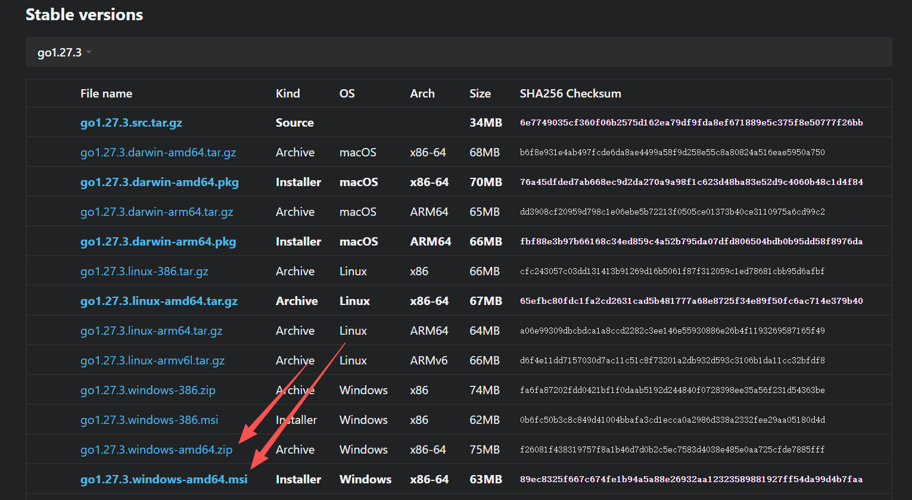
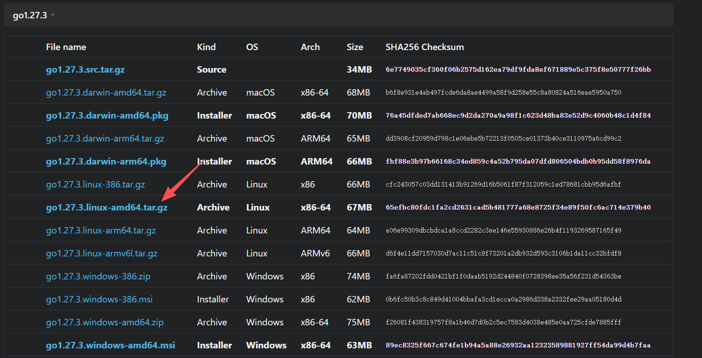

<!-- 封面：将 feature.png 或 feature.jpg 放在本篇 index.md 同目录下。发布前将 draft 改为 false。 -->

## Go 环境下载


 
 下载适用于 Windows、macOS 和 Linux 的 Go 安装包。
 



 
 下载适用于 Windows、macOS 和 Linux 的 Go 安装包。
 


## Windows 环境安装

Windows环境下，二选一即可。

若下载便携版，需要将GO的bin目录设置为环境变量，方便后续在命令行调用。

此外，还需要将用户目录下`~/go/bin` 设置为环境变量。在执行`go install`命令时，会自动将第三方Go工具安装到这个目录。



## Linux 环境安装



下载并解压

```bash
#切换到opt目录
cd /opt  
#下载安装包
wget https://studygolang.com/dl/golang/go1.21.3.linux-amd64.tar.gz 
#解压安装包
tar -xvf go1.21.3.linux-amd64.tar.gz 
```

```bash
vim /etc/profile

在文件后追加以下内容
export GOPROXY=https://goproxy.cn
export GOROOT=/opt/go
export PATH=$PATH:$GOROOT/bin
export GOPATH=/opt/go/pkg
export PATH=$PATH:$GOPATH/bin

退出并保存，刷新环境变量
source /etc/profile
```
